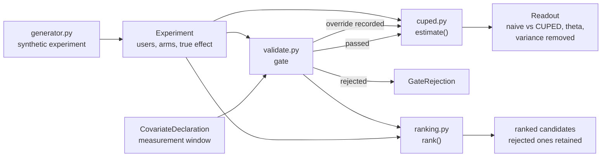

# cuped

CUPED variance reduction for A/B tests, with a gate that rejects post-treatment covariates, the mistake that silently biases the whole method.

[](https://github.com/SlateGitOrg/cuped/actions/workflows/ci.yml)

## Why

Experiments on revenue-type metrics need very large samples, because a handful of high-value customers dominate the variance. A test that would take eleven weeks to reach adequate power usually gets called early and wrong instead. CUPED removes the part of the variance that pre-experiment behaviour already explains, but it is only valid if the covariate really was measured before randomisation. Use one measured afterwards and the estimate becomes biased while the interval gets tighter, so the error looks like an improvement. This library refuses to run without a declared pre-period window and checks the data itself for the bias case.

## Features

- CUPED estimator with automatic, pooled theta estimation and variance-reduction reporting.
- Pre-treatment validation gate: declared window check plus a balance test across arms, which catches covariates that were declared as pre-period but are not.
- Covariate ranking by achieved variance reduction. The gate runs first, and rejected candidates stay in the output with their reasons.
- Readout comparing the naive and CUPED intervals, with the saving expressed as sample size.
- Recorded override (`override_gate=True`) for cases the automated checks cannot clear. It is flagged on the readout.
- Synthetic experiment generator with heavy-tailed revenue, a known true effect, and both valid and deliberately invalid covariates.
- Standard library only. Nothing to install.

## Architecture



`estimate()` is the only public entry point to the estimator and it runs the gate first. The gate combines a declaration check (the measurement window must close at or before randomisation and fit inside the pre-period) with an empirical balance check. See [docs/ARCHITECTURE.md](docs/ARCHITECTURE.md) for the full design.

## Quick start

Requires Python 3.11 or newer. There are no third-party dependencies.

```bash
git clone https://github.com/SlateGitOrg/cuped.git
cd cuped
python -m unittest discover -s tests -v   # run the suite (about 15 s)
python -m src.demo                        # run the end-to-end demo
```

## Usage

```python
from src.generator import generate
from src.cuped import estimate, GateRejection
from src.validate import CovariateDeclaration

exp = generate(n_users=30_000, true_effect=1.80, seed=5)

decl = CovariateDeclaration(
    covariate="pre_revenue",
    measurement_window_start_days_before_randomisation=28,
    measurement_window_end_days_before_randomisation=0,
    rationale="billed revenue in the 28 days before assignment",
)
r = estimate(exp, decl)
print(f"naive {r.naive.effect:.3f}  cuped {r.cuped.effect:.3f}  variance removed {r.variance_reduction:.1%}")
# naive 1.942  cuped 1.754  variance removed 38.7%

try:
    estimate(exp, CovariateDeclaration("post_engagement", 28, 0))
except GateRejection as e:
    print(e.gate.passed, e.gate.checks[-1], f"SMD {e.gate.balance_smd:+.3f}")
# False ('balanced_across_arms', False) SMD +0.480
```

### Measured results

From `python -m src.demo` (30,000 customers, seeded and reproducible; true effect planted at 1.80 per customer).

| estimator | effect | 95% interval | width |
| --- | --- | --- | --- |
| naive | 1.942 | [+1.518, +2.366] | 0.848 |
| CUPED (`pre_revenue`) | 1.754 | [+1.422, +2.086] | 0.664 |

Correlation is 0.622 and 38.7% of the variance is removed. Required sample scales with variance, so that is 38.7% less sample: an 11-week test becomes a 7-week one.

### What the gate prevents

The same analysis run with `post_engagement`, which is measured during the test window and moved by the treatment. It is declared with an identical 28-day pre-period window, so the metadata check sees nothing wrong:

| | `pre_revenue` (valid) | `post_engagement` (invalid) |
| --- | --- | --- |
| correlation | 0.622 | 0.976 |
| variance removed | 38.7% | 98.3% |
| interval width | 0.664 | **0.112** |
| estimated effect | 1.754 | **-6.601** |
| true effect | 1.800 | 1.800 |

The invalid covariate wins on every diagnostic an analyst normally looks at (higher correlation, more variance removed, an interval six times tighter) and returns an effect of the wrong sign, in an interval that excludes the truth. Nothing in the output indicates a problem, which is why this is a gate and not a warning. The balance test catches it: `SMD +0.480, z +41.6`.

## How it works

CUPED adjusts the outcome `Y` using a pre-period covariate `X`:

```
Y_adjusted = Y - theta * (X - mean(X)),   theta = cov(X, Y) / var(X)
```

The adjusted outcome has the same expectation as `Y` but variance reduced by a factor of `1 - corr(X, Y)^2`. The effect is then the ordinary difference in adjusted means.

- **Pooled theta.** Theta is estimated across both arms. Per-arm estimation lets the adjustment absorb part of the treatment effect and biases the estimate toward zero.
- **Five gate checks.** The covariate exists, is not the outcome, has a declared window that closes before randomisation, fits inside the available pre-period, and is balanced across arms.
- **Balance needs significance and magnitude.** The gate rejects only when p < 0.001 and the standardised mean difference is at least 0.02. A p-value-only gate rejects valid covariates more often as the sample grows, since it gains power to detect imbalance of no consequence.
- **Ranking gates before sorting.** On raw variance reduction the rejected covariate comes first, so a ranking that skipped the gate would recommend the mistake.

## Testing

```bash
python -m unittest discover -s tests -v
```

31 tests in `tests/test_bias.py` assert behaviour rather than just execution:

- unbiasedness of the CUPED estimate across many simulations with a valid covariate, and no manufactured effect when the true effect is zero;
- the planted post-treatment covariate is rejected, both when the declaration is honest and when it is misdeclared, and `estimate()` raises rather than warns;
- the invalid covariate really would have biased the estimate, excluded the truth and looked better on every diagnostic;
- variance reduction tracks the squared correlation, and a useless covariate removes almost nothing;
- pooled theta, covariate ranking behaviour, and numerical edge cases (tiny samples, constant covariates);
- the gate's false-positive rate on valid covariates is measured at 0.2% (1 in 500 at n=20,000) against a nominal alpha of 0.001.

CI runs the same command on every push.

## Project layout

```
src/
  cuped.py       estimator, Readout, GateRejection
  validate.py    CovariateDeclaration and the pre-treatment gate
  ranking.py     covariate ranking (gate first)
  generator.py   synthetic experiment with planted truth
  demo.py        end-to-end demo (python -m src.demo)
tests/
  test_bias.py   unbiasedness, gate and ranking tests
docs/
  ARCHITECTURE.md
```

## Limitations

- The gate detects post-treatment covariates that the treatment moves. A covariate measured after randomisation but genuinely unaffected by the treatment will pass, and is still unsafe because it can be a collider on a path between assignment and outcome. No quantity of data reveals that case; only the declaration and the judgement behind it do.
- The balance test is a hypothesis test, so it is occasionally wrong (0.2% false positives measured). That is why `override_gate` exists as a recorded part of the API.
- One estimator for a two-arm difference in means. Not an experimentation platform: no assignment, metric store or sequential testing.
- The demo runs on synthetic data.

## License

MIT — see [LICENSE](LICENSE).
