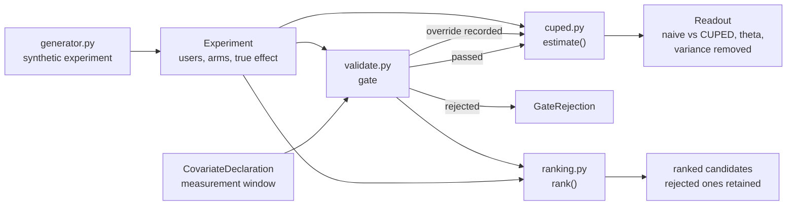

# Architecture

## Context

CUPED (Controlled-experiment Using Pre-Experiment Data) shrinks the variance of an A/B test metric by subtracting the part that a pre-experiment covariate already explains. The arithmetic is a single line; the failure mode is not in the arithmetic. If the covariate was measured after randomisation, the adjustment subtracts part of the treatment effect, and the result looks better (tighter interval, more variance removed) while being wrong. This library puts a validation gate in front of the estimator so that mistake is rejected instead of rewarded.

## Components

- `src/generator.py` produces a heavy-tailed (lognormal) revenue experiment with a planted true effect, one valid strong covariate (`pre_revenue`), one valid weak covariate (`signup_tenure_days`) and one invalid covariate (`post_engagement`) that is moved by the treatment.
- `src/validate.py` runs five checks: the covariate exists, it is not the outcome, the declared window closes before randomisation, the window fits inside the available pre-period, and the covariate is balanced across arms.
- `src/cuped.py` is the estimator. Its only public entry point, `estimate()`, runs the gate first.
- `src/ranking.py` gates every candidate before sorting, and keeps rejected candidates in the output with their reasons.

## Key decisions

**The gate raises, it does not warn.** The mistake being prevented produces output that looks better than the correct analysis, so a warning would be read as a success signal. `estimate()` raises `GateRejection`.

**Declaration plus balance.** The declared measurement window catches the honest mistake but is only metadata. Randomisation guarantees anything measured before assignment is distributed identically across arms, so a covariate that differs between arms by more than chance is post-treatment whatever the declaration says. Both checks are needed.

**Balance needs significance and a material SMD.** A z-test alone gains power with sample size and eventually rejects valid covariates over differences of no consequence. The gate requires p < 0.001 and a standardised mean difference of at least 0.02.

**theta is pooled across both arms.** Estimating it per arm lets the adjustment absorb part of the treatment effect and biases the estimate toward zero.

**Overrides are first-class.** `override_gate=True` exists for cases the automated checks cannot clear. It is recorded on the `Readout` (`overridden`), so it travels with the result.

**The saving is reported as sample size.** Required sample scales linearly with outcome variance, so removing a share r of the variance removes the same share of the sample.

## Failure modes

- A post-treatment covariate that the treatment moves: caught by the balance check, rejected.
- A missing covariate field: rejected with a reason, not a crash.
- A covariate equal to the outcome: rejected.
- A window longer than the available pre-period, or one that closes after randomisation: rejected.
- Balance false positives: measured at about 0.2% on a valid covariate (1 in 500 at n=20,000), asserted by a test. This is why the override exists.

## Out of scope

- A post-randomisation covariate that the treatment does not move passes the balance check yet is still unsafe, since it can be a collider. No amount of data reveals that; only the declaration and the analyst's judgement do.
- This is one estimator, not an experimentation platform: no assignment service, metric store or sequential testing.
